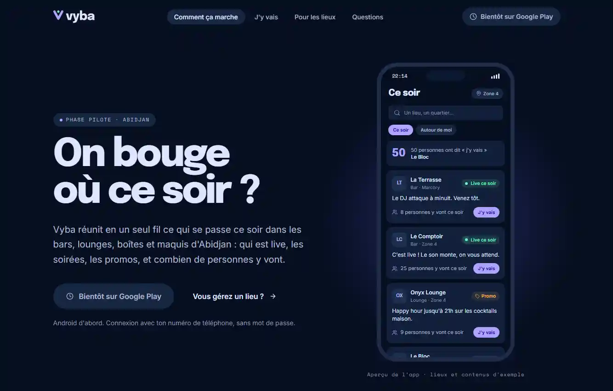
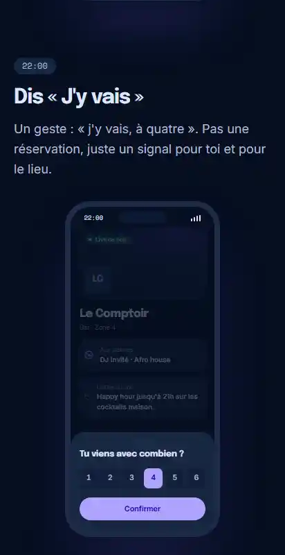
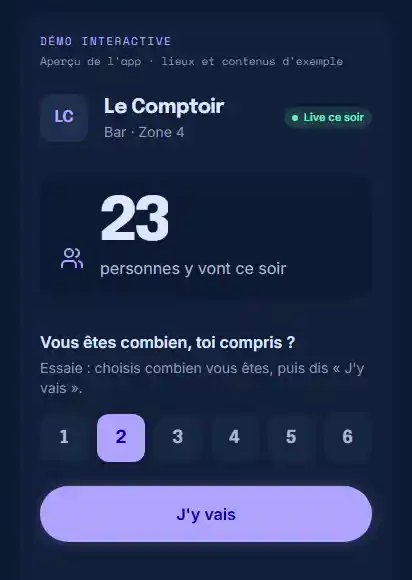
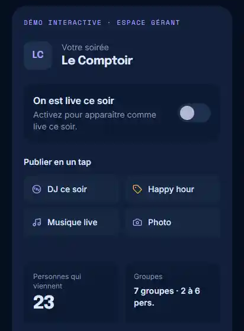
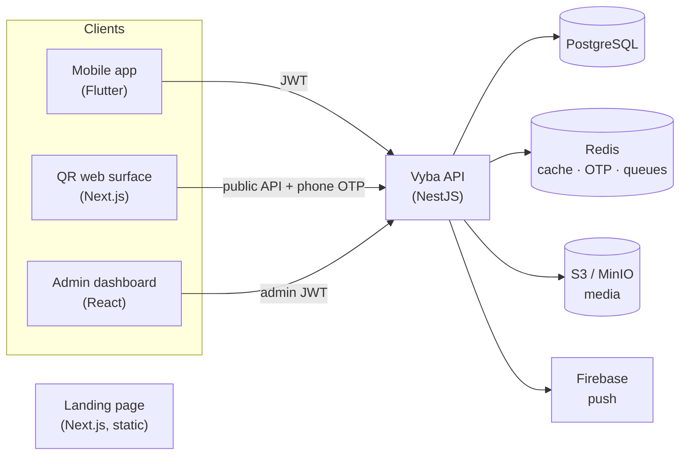

<p align="center">
  
</p>

<h3 align="center">On bouge où ce soir ?</h3>

<p align="center">
  Nightlife discovery and coordination for Abidjan, Côte d'Ivoire.<br />
  See what's happening tonight, signal that you're going, and help venues fill up.
</p>

<p align="center">
  
  
  
  
  
  
</p>

---

## What is Vyba?

Going out in Abidjan means piecing information together from WhatsApp statuses,
Instagram stories and word of mouth. Vyba centralises three things that are
otherwise scattered:

- **Discovery**: what's happening tonight, near me or anywhere in the city.
- **Promotion**: venues announce their night, their DJ and their offers.
- **Coordination**: a one-tap **"J'y vais"** ("I'm going") signal, shown publicly
  only as an aggregate ("23 personnes y vont ce soir").

**Who it's for**

| Actor | Uses |
|---|---|
| **People going out** | Mobile app (and a QR-code web page inside partner venues) |
| **Venue owners** (bars, lounges, nightclubs, *maquis*) | Owner mode of the mobile app |
| **The Vyba team** | Admin dashboard: onboarding venues, editorial, moderation, metrics |

> **Project phase: validation.** Vyba is proving one core loop with real venues
> and users before expanding: *Découvre → Vois ce qui se passe → J'y vais →
> Vis la soirée → Reviens*. Pilot venues are onboarded in **Zone 4 / Marcory**,
> the product is **French-only**, and distribution is **Android-first**. Anything
> that doesn't strengthen the loop is deliberately out of scope. See
> [`docs/validation-mvp/VYBA_VALIDATION_MVP_SPEC.md`](docs/validation-mvp/VYBA_VALIDATION_MVP_SPEC.md).

## Preview

Screenshots from the marketing landing page ([`vyba-landing-page/`](vyba-landing-page/)).
The phone screens are code-rendered previews of the app built from its design
tokens, populated with **sample venues**.

<p align="center">
  
</p>

<table>
  <tr>
    <td align="center" width="25%"><br /><sub>Mobile hero</sub></td>
    <td align="center" width="25%"><br /><sub>"J'y vais" party-size sheet</sub></td>
    <td align="center" width="25%"><br /><sub>Interactive "J'y vais" demo</sub></td>
    <td align="center" width="25%"><br /><sub>Venue-owner console demo</sub></td>
  </tr>
</table>

## Key features

- **"Ce soir" feed**: ranked server-side by time relevance (tonight → weekend →
  upcoming → recent), with a bounded lift for followed venues. It mixes venue
  updates, live status, promos, events, editorial and going milestones.
- **"J'y vais" intent signal**: soft intent, not a booking. One per user, venue
  and night, editable until midnight. Public counts are aggregates only, and
  owners can't inflate their own count ([ADR-0002](docs/adr/0002-soft-jy-vais-intent-instead-of-reservations.md)).
- **VenueNight model**: all night-scoped state (live status, tonight's DJ,
  promos, photos, intent) belongs to *one venue on one night*
  ([ADR-0001](docs/adr/0001-venuenight-as-temporal-spine.md)).
- **Venue-owner tools**: one-tap "On est live ce soir", quick posts, photos,
  attendance intent and opt-in broadcasts.
- **Optional reservations**: same-night table requests, opt-in per venue and
  capacity-gated ([ADR-0006](docs/adr/0006-optional-per-venue-reservations.md)).
- **Phone + OTP identity**: no passwords and no social login
  ([ADR-0003](docs/adr/0003-phone-otp-as-sole-identity.md)).
- **QR-code web surface**: a lightweight Next.js page for first-time visitors
  scanning a table QR code on a poor connection ([ADR-0004](docs/adr/0004-separate-lightweight-web-surface.md)).
- **Validation metrics**: acquisition attribution, weekly actives, retention,
  and organic vs. team-assisted content, all in the admin dashboard.

## Repository structure

A monorepo of five independently built and deployed applications. Each has its
own toolchain and package manager.

| Path | Role | Stack | Package manager |
|---|---|---|---|
| [`Vyba-backend/`](Vyba-backend/) | REST API, the source of truth for identity and permissions | NestJS 11, TypeORM, PostgreSQL 16, Redis, BullMQ, Socket.IO, S3/MinIO, Firebase Admin | yarn |
| [`Vyba-mobile-app/`](Vyba-mobile-app/) | Client and venue-owner app | Flutter (Dart ≥ 3.6), Riverpod, GoRouter, Dio, Freezed, dartz | flutter / make |
| [`Vyba-dashboard-admin/`](Vyba-dashboard-admin/) | Vyba team operations dashboard | React 19, Vite 6, TanStack Router/Query/Table, Zustand, shadcn/ui, Tailwind 4 | pnpm |
| [`Vyba-web/`](Vyba-web/) | QR-scan surface: venue page, Zone 4 feed, web "J'y vais" | Next.js 15 (App Router, RSC), Vitest + MSW | npm |
| [`vyba-landing-page/`](vyba-landing-page/) | Public marketing site | Next.js 16, Tailwind 4, next-intl, framer-motion | npm |

```
.
├── Vyba-backend/          # NestJS API: src/modules/<feature>, src/common/ infrastructure
├── Vyba-mobile-app/       # Flutter app: lib/features/<feature>/{domain,data,presentation}
├── Vyba-dashboard-admin/  # React admin: src/features/<feature>, file-based routes
├── Vyba-web/              # Next.js QR surface: app/[venueId], app/zone4
├── vyba-landing-page/     # Next.js marketing site
├── docs/
│   ├── adr/               # Architecture Decision Records (0001–0006)
│   ├── validation-mvp/    # Product spec + codebase audit
│   ├── images/            # README screenshots
│   ├── ARCHITECTURE.md · SETUP.md · API.md · DEPLOYMENT.md
│   └── backend.md · mobile.md · dashboard.md · design-system.md · security.md
├── CONTEXT.md             # Product & domain glossary
└── CONTRIBUTING.md
```

## Architecture overview



- The **backend re-validates identity and permissions on every request**. Roles
  on the clients are UX hints only.
- The mobile app uses **Clean Architecture per feature**; use cases return
  `Either<Failure, T>` and state is a Freezed sealed union.
- The landing page is fully static and talks to no API.

Full write-up: [`docs/ARCHITECTURE.md`](docs/ARCHITECTURE.md).

## Getting started

**Prerequisites:** Node.js 20, yarn, pnpm, Docker (for Postgres, Redis and MinIO),
and the Flutter SDK (stable channel) for the mobile app.

```bash
# 1. Infrastructure + API
cd Vyba-backend
cp .env.example .env              # then set JWT_SECRET / JWT_REFRESH_SECRET
yarn install
docker compose up -d              # PostgreSQL, Redis, MinIO, Adminer
yarn start:dev                    # http://localhost:3000 · Swagger: /api/docs

# 2. Admin dashboard
cd ../Vyba-dashboard-admin
cp .env.example .env              # VITE_API_URL=http://localhost:3000/api
pnpm install && pnpm dev          # http://localhost:5173

# 3. QR web surface
cd ../Vyba-web
cp .env.example .env.local
npm install && npm run dev        # http://localhost:3001

# 4. Mobile app
cd ../Vyba-mobile-app
cp .env.example .env
make get && make gen && make run

# 5. Landing page (no backend needed)
cd ../vyba-landing-page
npm install && npm run dev -- -p 3002
```

The step-by-step guide, covering ports, CORS, the first admin account and
troubleshooting, is in [`docs/SETUP.md`](docs/SETUP.md).

## Environment variables

Every app ships a `.env.example`. These are the key variables:

| App | Variables |
|---|---|
| Backend | `PORT`, `CORS_ORIGINS`, `DB_*`, `JWT_SECRET`, `JWT_REFRESH_SECRET`, `REDIS_*`, `S3_*`, `MAIL_*`, `RUNNING_IN_DOCKER`; optional `SEED_ADMIN_EMAIL` / `SEED_ADMIN_PASSWORD` |
| Dashboard | `VITE_API_URL`, `VITE_AUTH_TOKEN_KEY`, `VITE_APP_NAME` (public, embedded in the bundle) |
| QR web | `API_BASE_URL`, `NEXT_PUBLIC_API_BASE_URL`, `NEXT_PUBLIC_PLAY_STORE_URL` |
| Mobile | `ENV_NAME`, `BASE_URL`, `ENABLE_LOGGING`, `SHOW_DEBUG_BANNER`, `USE_MOCK_AUTH` (must stay `false` outside development), `SUPPORT_WHATSAPP_NUMBER` |
| Landing | `NEXT_PUBLIC_SITE_URL`, `NEXT_PUBLIC_PLAY_STORE_URL`, `NEXT_PUBLIC_WHATSAPP_NUMBER`, `NEXT_PUBLIC_CONTACT_EMAIL` |

Never commit real `.env` files or secrets ([`docs/security.md`](docs/security.md)).

## Scripts

| App | Dev | Test | Lint / analyze | Build |
|---|---|---|---|---|
| Backend | `yarn start:dev` | `yarn test` · `yarn test:e2e` | `yarn lint` | `yarn build` |
| Dashboard | `pnpm dev` | `pnpm test` | `pnpm lint` · `pnpm knip` | `pnpm build` |
| QR web | `npm run dev` | `npm test` | `npm run lint` | `npm run build` |
| Mobile | `make run` | `make test` · `make integration` | `make analyze` | `flutter build apk` |
| Landing | `npm run dev` | n/a | `npm run lint` · `npm run typecheck` | `npm run build` |

Backend database migrations: `yarn migration:generate | migration:run | migration:revert`.
In development, TypeORM auto-syncs the schema.

## API

- Interactive documentation (Swagger): `http://localhost:3000/api/docs`
- Health check: `GET /health`
- REST routes live under `/api/*` and are grouped by module (auth, feed, going,
  venues, venue nights, follows, reservations, media, notifications, metrics,
  attribution, analytics, users).

Module-by-module map: [`docs/API.md`](docs/API.md).

## Authentication

| Who | How |
|---|---|
| People going out and venue owners | Phone number + one-time code (`/api/auth/request-code` → `/api/auth/verify-code`), then JWT access + refresh tokens |
| Vyba team | Email + password admin login (`/api/auth/admin/login`), JWT with admin roles |

Owner accounts are provisioned by the Vyba team after an on-site visit. There is
no self-service venue claiming. Clients must check JWT `exp` before using a token.

## Testing

Unit and integration tests exist in the backend (Jest), the dashboard (Vitest),
the QR web surface (Vitest + MSW, the project's API test seam) and the mobile
app (`flutter test`, with integration tests under `integration_test/`). Details
per app: [`docs/SETUP.md#running-tests`](docs/SETUP.md#running-tests).

## Deployment

- **Backend**: multi-stage `Dockerfile` (Node 20 Alpine, port 3000), plus
  managed PostgreSQL, Redis and S3-compatible storage.
- **Dashboard**: `Dockerfile` that builds with Node and serves with nginx on port 80.
- **QR web and landing page**: standard Next.js builds (`next build` / `next start`)
  for any Node host or Vercel. The landing page is fully static.
- **Mobile**: Google Play (closed testing track first). iOS via TestFlight only if needed.

Details and production checklist: [`docs/DEPLOYMENT.md`](docs/DEPLOYMENT.md).

## Documentation

| Document | Contents |
|---|---|
| [`CONTEXT.md`](CONTEXT.md) | Product concepts, glossary, actors, invariants |
| [`docs/ARCHITECTURE.md`](docs/ARCHITECTURE.md) | System design and data flow |
| [`docs/SETUP.md`](docs/SETUP.md) | Local development, step by step |
| [`docs/API.md`](docs/API.md) | API surface by module |
| [`docs/DEPLOYMENT.md`](docs/DEPLOYMENT.md) | Build and deploy each app |
| [`docs/adr/`](docs/adr/README.md) | Architecture Decision Records |
| [`docs/backend.md`](docs/backend.md) · [`docs/mobile.md`](docs/mobile.md) · [`docs/dashboard.md`](docs/dashboard.md) | Per-app conventions and internals |
| [`docs/design-system.md`](docs/design-system.md) | "Abidjan Pulse" design rules |
| [`docs/security.md`](docs/security.md) | Security framework and audit checklist |
| [`docs/validation-mvp/`](docs/validation-mvp/) | Validation spec and codebase audit |
| [`CONTRIBUTING.md`](CONTRIBUTING.md) | Branching, commits, checks |

## Known limitations

- **No real SMS provider yet.** OTP codes go to an in-memory `FakeSmsProvider`;
  in staging and production the backend logs an error and codes are not
  delivered. Phone login cannot work for real users until a vendor is integrated.
- **CI is not active.** The workflows live in `Vyba-mobile-app/.github/` and
  `Vyba-dashboard-admin/.github/`, but GitHub only runs workflows from the
  repository-root `.github/workflows/`. There is no backend or web CI.
- **Deferred by design** (post-validation): paid boosts, SaaS billing, reviews,
  full table booking, iOS App Store release.
- **Template-era READMEs.** Sub-project READMEs still describe their starter
  templates. The `docs/*.md` guides are the maintained references.
- **Product analytics are stubbed.** PostHog is wired through a
  `FakePostHogClient`; no real client exists yet.
- **No going-count boost in feed ranking yet.** The spec calls for one, but the
  code leaves it for a future ticket.
- **Landing-page visuals use sample content** until real app screenshots exist.

## Roadmap

From the validation spec, sequenced *validate engagement → validate organic
supply → validate monetization → expand*:

- Integrate a real SMS (and possibly WhatsApp) OTP provider.
- Move CI to the repository root and add backend and web pipelines.
- Paid feed and discovery **boosts** for venues, the intended primary revenue line.
- An optional venue-owner SaaS subscription.
- Expansion beyond the Zone 4 / Marcory pilot.

## License

No license has been chosen yet: there is no root `LICENSE`, and
`Vyba-dashboard-admin/LICENSE` is empty. Until one is added, all rights are
reserved by the authors.
