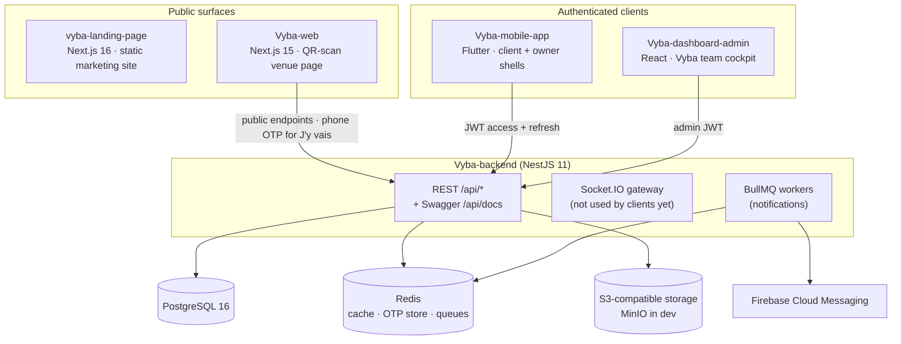
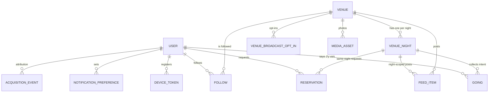
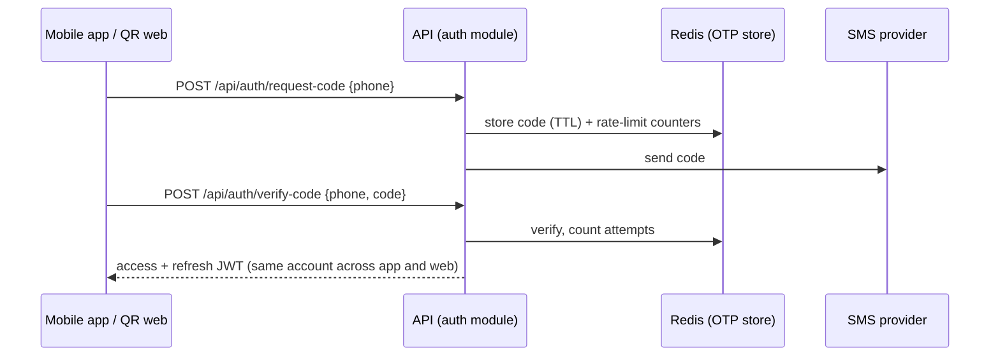

# Architecture

How Vyba's five applications fit together, and the domain model that runs
through them. This document is a map. Each app's internals live in its own guide
([backend](backend.md) · [mobile](mobile.md) · [dashboard](dashboard.md)), the
vocabulary lives in [`CONTEXT.md`](../CONTEXT.md), and the *why* behind each
decision lives in the [ADRs](adr/README.md).

## System overview

| App | Talks to | Notes |
|---|---|---|
| Mobile app | API (JWT) | The "power surface": personalised feed, follows, notifications, owner tools |
| QR web surface | API public endpoints | Read-mostly. Must show meaningful content in under 1 s, with a 2.5 s ceiling ([ADR-0004](adr/0004-separate-lightweight-web-surface.md)) |
| Admin dashboard | API (admin JWT) | Venue onboarding, editorial, curation, metrics |
| Landing page | Nothing | Static HTML. CTAs link to Google Play and WhatsApp |

## Domain model

All night-scoped state hangs off a **VenueNight**, meaning one venue on one
calendar night, never off mutable fields on `Venue`
([ADR-0001](adr/0001-venuenight-as-temporal-spine.md)).

Entities live in `Vyba-backend/src/modules/*/entities/`. Schema changes ship as
TypeORM migrations in `Vyba-backend/src/common/database/migrations/`.

| Concept | Rule worth knowing |
|---|---|
| **Going ("J'y vais")** | One per user, venue and night; editable until midnight. Public output is an aggregate count. Owners can't inflate their own count ([ADR-0002](adr/0002-soft-jy-vais-intent-instead-of-reservations.md)) |
| **FeedItem** | One polymorphic type: `venue_update`, `live_tonight`, `promo`, `event`, `editorial`, `going_milestone`, `photo`. Records `created_by` and whether the team **assisted**, which the validation metrics depend on and the server enforces |
| **Reservation** | Opt-in per venue (`reservationsEnabled`), same-night only, capacity-gated, confirmed by the owner ([ADR-0006](adr/0006-optional-per-venue-reservations.md)) |
| **Venue discovery** | Not geofenced: any active venue is discoverable by text or proximity ([ADR-0005](adr/0005-venue-discovery-not-geofenced.md)) |

## Key flows

### Feed ranking
Computed **server-side at request time**, with no per-user precomputed feeds
(`src/modules/feed/feed-ranking.util.ts`). Items are bucketed into tiers
`TONIGHT → THIS_WEEKEND (Thu–Sun) → UPCOMING → RECENT (48 h) → EVERGREEN`, then
ordered within each tier by recency. A followed venue's items get a bounded
3-hour lift, which never crosses a tier boundary. The spec's going-count
boost is not implemented yet; the code leaves it for a future ticket.

### Phone + OTP sign-in

Phone number is the only identity primitive ([ADR-0003](adr/0003-phone-otp-as-sole-identity.md)).
The admin dashboard uses a separate email + password login
(`/api/auth/admin/login`). The first admin can be bootstrapped with
`SEED_ADMIN_EMAIL` / `SEED_ADMIN_PASSWORD`.

> **Current state:** only a `FakeSmsProvider` exists (`src/common/sms/`), so no
> code is actually sent. See [Known limitations](../README.md#known-limitations).

### QR acquisition
`venue table QR → Vyba-web /[venueId]?src=qr… → venue night + going count →
phone OTP → "J'y vais" → Zone 4 feed → app install prompt (only after value)`.
Attribution parameters are captured at landing (`/api/attribution/landing`) and
kept separate from the user's active zone, so retention can be analysed by source.

### Scheduled notifications
BullMQ repeatable jobs on the notifications queue (Africa/Abidjan is UTC+0):

| Job | Schedule |
|---|---|
| Weekend digest | Thursday 17:00 (`0 17 * * 4`) |
| "J'y vais" reminder | Daily 20:00 (`0 20 * * *`) |

## Cross-cutting rules

- **The backend is the source of truth.** Every request is re-validated, and
  client-side roles are UX hints only.
- **Security:** HTTPS only, never log tokens, OTPs or PII, and check JWT `exp`
  client-side before use. Full framework: [`security.md`](security.md).
- **Design:** dark-first, no pure black, no 1px borders, radius ≥ 8px, and
  semantic brand colours. See [`design-system.md`](design-system.md).
- **Language:** French only for the validation build.

## Per-app architecture

| App | Pattern | Guide |
|---|---|---|
| Backend | Modular NestJS: `src/modules/<feature>` on shared `src/common/` (config, database, guards, redis, queues, storage, sms, firebase, websockets…) | [`backend.md`](backend.md) |
| Mobile | Clean Architecture per feature (`domain` / `data` / `presentation`), Riverpod DI, GoRouter role shells | [`mobile.md`](mobile.md) |
| Dashboard | Feature folders; CRUD resources as TanStack Tables with dialog-driven create/edit | [`dashboard.md`](dashboard.md) |
| QR web | Next.js App Router with React Server Components; MSW-mocked API as the test seam | [`../Vyba-web/README.md`](../Vyba-web/README.md) |
| Landing | Next.js SSG, feature sections, code-rendered device previews | [`../vyba-landing-page/README.md`](../vyba-landing-page/README.md) |
